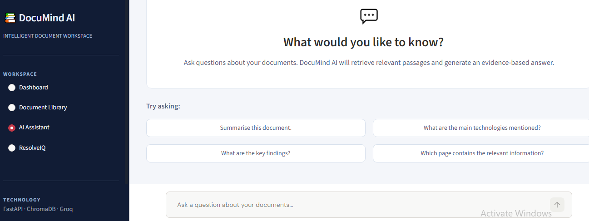

# DocuMind AI — Enterprise AI Document Assistant

An AI-powered document assistant that enables users to upload PDF documents, search their contents using semantic retrieval, and ask natural-language questions with context-grounded answers and source references.

## Overview

DocuMind AI is a Retrieval-Augmented Generation (RAG) application built using Python, FastAPI, Streamlit, ChromaDB, Sentence Transformers and Groq.

Instead of relying only on an LLM's pre-trained knowledge, the application retrieves relevant passages from uploaded documents and uses them as context when generating answers.

## Key Features

- **PDF document ingestion:** Upload and extract text from PDF files.
- **Text chunking:** Split extracted content into manageable chunks with overlap.
- **Semantic search:** Retrieve relevant passages using vector embeddings.
- **Vector database:** Store and retrieve document embeddings using ChromaDB.
- **AI question answering:** Generate context-grounded responses using Groq-hosted LLMs.
- **Source references:** Display document and page information supporting answers.
- **Document management:** View and delete uploaded documents.
- **REST API:** Backend endpoints built using FastAPI.
- **Interactive interface:** Streamlit-based user interface.

## Application Screenshots

DocuMind AI includes a dashboard, document management interface, AI-powered question answering, and source evidence for answer verification.

### Dashboard


### Document Library


### AI Assistant



### Source Evidence

Answers include expandable source evidence with document filenames and page references, helping users verify generated responses against the original PDFs.


## Technology Stack

| Component       | Technology                               |
| --------------- | ---------------------------------------- |
| Language        | Python                                   |
| Backend         | FastAPI                                  |
| Frontend        | Streamlit                                |
| LLM Provider    | Groq                                     |
| Embeddings      | Sentence Transformers — all-MiniLM-L6-v2 |
| Vector Database | ChromaDB                                 |
| PDF Processing  | PyMuPDF                                  |
| API Testing     | Pytest, HTTPX                            |

## Architecture

The application follows a RAG-based architecture:

1. A user uploads a PDF document.
2. PyMuPDF extracts its text.
3. The chunking service splits the text into overlapping sections.
4. Sentence Transformers converts the chunks into vector embeddings.
5. ChromaDB stores the embeddings and document metadata.
6. A user submits a question.
7. Semantic retrieval finds relevant document chunks.
8. The retrieved context is passed to the Groq LLM.
9. The application returns an answer with source references.

## Project Structure

```text
ai-document-assistant/
│
├── app/
│   ├── main.py
│   └── services/
│       ├── chunking.py
│       ├── embeddings.py
│       ├── rag.py
│       └── vector_store.py
│
├── frontend/
│   └── streamlit_app.py
│
├── tests/
│   ├── test_api.py
│   ├── test_chunking.py
│   └── test_rag.py
│
├── docs/
│   ├── architecture.md
│   ├── deployment.md
│   ├── portfolio-project-description.md
│   ├── screenshot-checklist.md
│   ├── technical-documentation.md
│   └── images/
│       ├── dashboard.PNG
│       ├── document-library.PNG
│       ├── ai-assistant.PNG
│       └── source-evidence.PNG
│
├── requirements.txt
├── .env.example
├── .gitignore
└── README.md
```

## Local Setup

### 1. Clone the repository

```bash
git clone https://github.com/nujumniza/ai-document-assistant-documind.git
cd ai-document-assistant-documind
```

### 2. Create a virtual environment

```bash
python -m venv .venv
```

Activate it on Windows PowerShell:

```powershell
.venv\Scripts\Activate.ps1
```

### 3. Install dependencies

```bash
pip install -r requirements.txt
```

### 4. Configure environment variables

Create a `.env` file in the project root:

```env
LLM_PROVIDER=groq
GROQ_MODEL=openai/gpt-oss-20b
GROQ_API_KEY=your_groq_api_key
```

Obtain an API key from the Groq developer platform. Never commit your actual `.env` file or API key to GitHub.

### 5. Start the backend

```bash
python -m uvicorn app.main:app --host 127.0.0.1 --port 8000
```

Backend API documentation:

http://127.0.0.1:8000/docs

### 6. Start the frontend

Open a second terminal:

```bash
python -m streamlit run frontend/streamlit_app.py
```

Open the local Streamlit URL displayed in the terminal, usually:

http://localhost:8501

## API Endpoints

| Method | Endpoint                   | Purpose                       |
| ------ | -------------------------- | ----------------------------- |
| GET    | `/`                        | Application welcome           |
| GET    | `/health`                  | Health status                 |
| POST   | `/documents/upload`        | Upload a PDF                  |
| GET    | `/documents`               | List documents                |
| POST   | `/documents/search`        | Semantic document search      |
| POST   | `/documents/ask`           | Ask questions about documents |
| DELETE | `/documents/{document_id}` | Delete a document             |

## Testing

Run the test suite:

```bash
pytest -v
```

The project includes tests covering API endpoints, text chunking and RAG functionality.

## Current Limitations

This is a portfolio and learning project, not yet a production-ready enterprise deployment.

Current limitations include:

- No authentication or role-based access control.
- No multi-tenant data isolation.
- No OCR pipeline for scanned PDFs.
- No production-grade audit logging or rate limiting.
- No persistent conversational memory across separate question requests.

## Future Improvements

- User authentication and access management.
- Multi-user document isolation.
- OCR support for scanned documents.
- Improved document evaluation and retrieval metrics.
- Conversation history and contextual follow-up questions.
- Cloud deployment and monitoring.
- Security and production-readiness improvements.

## Author

**Nujumniza Shanavaz**

GitHub: https://github.com/nujumniza

---

_DocuMind AI — Making document knowledge easier to access through Retrieval-Augmented Generation._
