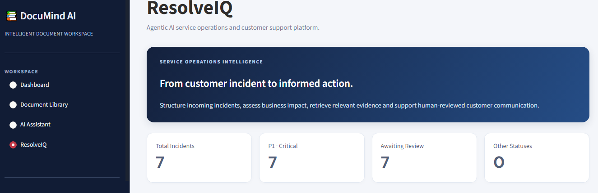
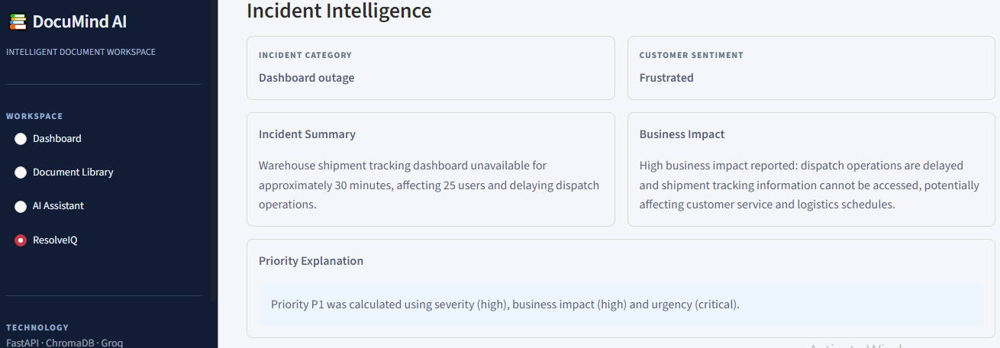
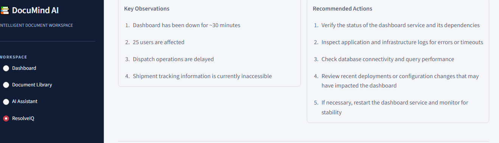
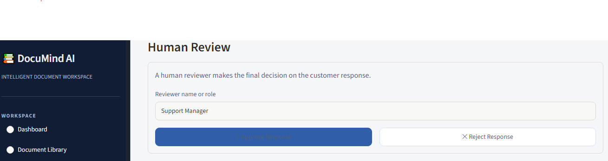
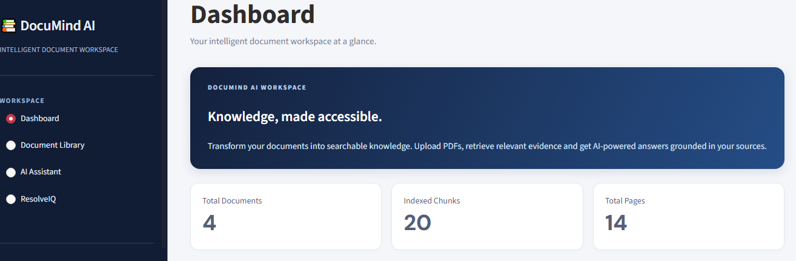
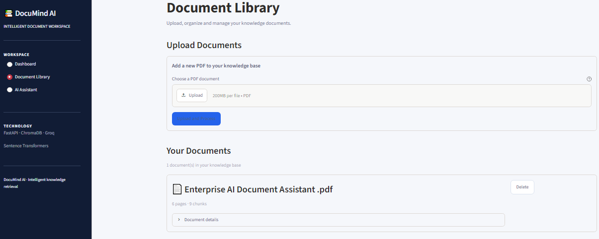
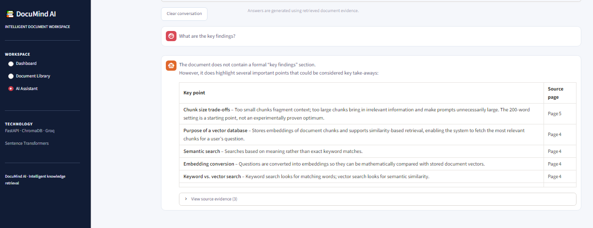

# ResolveIQ — Agentic AI Service Operations & Customer Support Platform

An AI-powered service operations platform that combines incident intelligence, Retrieval-Augmented Generation (RAG), and a tool-using AI investigation agent to help support teams analyse customer incidents, assess business impact, retrieve relevant knowledge, and prepare customer responses for human review.

Built using Python, FastAPI, Streamlit, Groq, ChromaDB, Sentence Transformers, and SQLite.

## Overview

ResolveIQ brings incident analysis, AI-assisted investigation, organisational knowledge retrieval, and human approval into one workflow.

The platform helps support teams:

- Analyse and classify customer-reported incidents.
- Identify customer sentiment and summarise business impact.
- Calculate incident priority using severity, impact, and urgency.
- Generate customer response drafts.
- Retrieve relevant historical incidents and support knowledge.
- Use an AI agent to investigate incidents through controlled tool calls.
- Review, edit, approve, or reject AI-generated responses.
- Maintain investigation and human review histories.

ResolveIQ incorporates **DocuMind AI**, an AI document assistant that provides semantic search and context-grounded question answering over uploaded PDF documents.

The platform is designed with human oversight. AI-generated recommendations and customer responses require human review. Approval does not automatically send an email or execute external actions.

## Key Features

### 1. Incident Intelligence

- Customer incident submission and management.
- AI-assisted incident classification.
- Customer sentiment analysis.
- Incident summarisation and business-impact assessment.
- Rule-based P1–P4 priority calculation using severity, impact, and urgency.
- Configured response targets based on incident priority.
- AI-generated customer response drafts.

### 2. Agentic AI Investigation

A central tool-using AI agent supports incident investigation by retrieving:

- Relevant historical incidents for the same organisation and customer.
- Applicable support policy information.
- Organisation-specific knowledge from uploaded documents.

The agent combines retrieved information into an investigation report and records the tools used and their outputs.

The investigation workflow uses bounded tool interactions and read-only retrieval. It does not independently modify external systems or send customer communications.

### 3. Retrieval-Augmented Generation (RAG)

The integrated document intelligence capability provides:

- PDF document upload and text extraction.
- Text chunking with overlap.
- Semantic retrieval using vector embeddings.
- Persistent vector storage using ChromaDB.
- Context-grounded question answering through Groq-hosted LLMs.
- Source evidence with document filenames and page references.
- Organisation-scoped knowledge retrieval for ResolveIQ.

### 4. Human Review and Approval

- Review AI-generated customer responses.
- Edit response drafts before approval.
- Approve or reject proposed responses.
- Record reviewer decisions.
- Maintain review history.
- Keep human approval separate from actual email delivery.

### 5. DocuMind AI Document Assistant

- Upload and manage PDF documents.
- Search document contents semantically.
- Ask natural-language questions.
- Retrieve relevant document passages.
- Generate context-grounded answers.
- Inspect source evidence to verify answers against original documents.

## Application Screenshots

The following screenshots demonstrate the main interfaces and workflows of DocuMind AI and ResolveIQ.

### ResolveIQ — Agentic AI Service Operations

#### 1. ResolveIQ Dashboard



The dashboard provides an overview of recorded incidents, priority distribution, pending human reviews, and the incident workspace.

#### 2. Incident Intelligence



Demonstrates AI-assisted incident classification, sentiment analysis, incident summarisation, business-impact assessment, priority calculation, and recommended actions.

#### 3. AI Investigation Report



Shows the investigation agent retrieving historical incident information, support policy details, and organisation-specific knowledge to produce an investigation report.

#### 4. Human Review and Approval



Demonstrates the customer response draft, editable response, human approval controls, and recorded review decisions.

### DocuMind AI — Document Intelligence

#### 5. Dashboard



Provides an overview of document statistics, system health, LLM provider status, and recently uploaded documents.

#### 6. Document Library



Shows PDF upload, indexed documents, page and chunk counts, and document management controls.

#### 7. AI Assistant


Demonstrates natural-language question answering using information retrieved from uploaded documents.

#### 8. Source Evidence



Shows an AI-generated answer alongside expandable source evidence, including document filenames and page references, allowing users to verify responses against the original documents.

## Technology Stack

| Component            | Technology                               |
| -------------------- | ---------------------------------------- |
| Programming language | Python                                   |
| Backend framework    | FastAPI                                  |
| Frontend framework   | Streamlit                                |
| LLM provider         | Groq                                     |
| LLM integration      | Groq API and tool calling                |
| Embedding model      | Sentence Transformers — all-MiniLM-L6-v2 |
| Vector database      | ChromaDB                                 |
| Relational database  | SQLite                                   |
| PDF processing       | PyMuPDF                                  |
| API testing          | Pytest, HTTPX                            |

## System Architecture

ResolveIQ combines an incident intelligence workflow with a RAG-based knowledge retrieval pipeline and a tool-using investigation agent.

### Incident Intelligence Workflow

1. A support user submits a customer-reported incident.
2. The application processes the incident information.
3. The LLM assists with classification, sentiment analysis, summarisation, and customer response drafting.
4. Python-based business rules calculate incident priority using severity, impact, and urgency.
5. The incident analysis is stored in SQLite.
6. A support user initiates an AI investigation when required.
7. The investigation agent retrieves relevant historical incidents, support policy information, and organisation-specific knowledge.
8. The agent generates an investigation report with tool usage and retrieved evidence.
9. A human reviewer examines the findings and customer response.
10. The reviewer can edit, approve, or reject the response. The decision is recorded for review history.

### Document Retrieval Workflow

1. A user uploads a PDF document.
2. PyMuPDF extracts the document text.
3. The chunking service divides the text into overlapping sections.
4. Sentence Transformers generates vector embeddings.
5. ChromaDB stores embeddings and associated metadata.
6. A user submits a natural-language question.
7. Semantic retrieval identifies relevant document passages.
8. Retrieved context is supplied to the Groq-hosted LLM.
9. The application returns a context-grounded answer with source references.

## Project Structure

```text
ai-document-assistant/
│
├── app/
│   ├── main.py
│   └── services/
│       ├── chunking.py
│       ├── embeddings.py
│       ├── vector_store.py
│       ├── rag.py
│       ├── incident_intelligence.py
│       ├── incident_agent.py
│       └── human_review.py
│
├── frontend/
│   └── streamlit_app.py
│
├── tests/
│
├── data/
│   └── (runtime databases and vector data)
│
├── docs/
│   ├── architecture.md
│   ├── deployment.md
│   ├── portfolio-project-description.md
│   ├── screenshot-checklist.md
│   ├── technical-documentation.md
│   └── images/
│       ├── ResolveIQ-Dashboard.PNG
│       ├── Incident-Intelligence.PNG
│       ├── AI-Investigation-Report.PNG
│       ├── human-review-approval.PNG
│       ├── dashboard.PNG
│       ├── document-library.PNG
│       ├── ai-assistant.PNG
│       └── source-evidence.PNG
│
├── requirements.txt
├── .env.example
├── .gitignore
└── README.md
```

## Local Setup

### 1. Clone the repository

```bash
git clone https://github.com/nujumniza/ai-document-assistant-documind.git
cd ai-document-assistant-documind
```

### 2. Create a virtual environment

```bash
python -m venv .venv
```

Activate it on Windows PowerShell:

```powershell
.venv\Scripts\Activate.ps1
```

### 3. Install dependencies

```bash
pip install -r requirements.txt
```

### 4. Configure environment variables

Create a `.env` file in the project root using `.env.example` as a template.

Example configuration:

```env
LLM_PROVIDER=groq
GROQ_MODEL=openai/gpt-oss-20b
GROQ_API_KEY=your_groq_api_key
```

Obtain an API key from the Groq developer platform.

Never commit your actual `.env` file or API key to GitHub.

### 5. Start the backend

```bash
python -m uvicorn app.main:app --host 127.0.0.1 --port 8000
```

FastAPI interactive documentation:

http://127.0.0.1:8000/docs

### 6. Start the frontend

Open a second terminal:

```bash
python -m streamlit run frontend/streamlit_app.py
```

Open the Streamlit URL displayed in the terminal, usually:

http://localhost:8501

## Main API Endpoints

### Document Assistant

| Method | Endpoint                   | Purpose                       |
| ------ | -------------------------- | ----------------------------- |
| GET    | `/`                        | Application welcome           |
| GET    | `/health`                  | Health status                 |
| POST   | `/documents/upload`        | Upload a PDF                  |
| GET    | `/documents`               | List documents                |
| POST   | `/documents/search`        | Semantic document search      |
| POST   | `/documents/ask`           | Ask questions about documents |
| DELETE | `/documents/{document_id}` | Delete a document             |

### ResolveIQ

| Method | Endpoint                                  | Purpose                                |
| ------ | ----------------------------------------- | -------------------------------------- |
| POST   | `/incidents/analyze`                      | Analyse and record an incident         |
| GET    | `/incidents`                              | Retrieve recorded incidents            |
| POST   | `/incidents/{incident_id}/investigate`    | Run the investigation agent            |
| GET    | `/incidents/{incident_id}/investigations` | Retrieve investigation history         |
| POST   | `/incidents/{incident_id}/review`         | Record a human review decision         |
| GET    | `/incidents/{incident_id}/reviews`        | Retrieve review history                |
| POST   | `/resolveiq/knowledge/upload`             | Upload organisation-specific knowledge |

## Testing

Run the available test suite:

```bash
pytest -v
```

The project includes tests covering core API functionality, text chunking, and RAG functionality.

## Current Limitations

ResolveIQ is a portfolio demonstration and is not yet a production-ready enterprise deployment.

Current limitations include:

- No user authentication or role-based access control.
- No production-grade multi-tenant security implementation.
- No OCR pipeline for scanned PDFs.
- No real email integration or automatic customer response delivery.
- No direct integration with external customer, vendor, or monitoring systems.
- No autonomous execution of external operational actions.
- No production-grade audit infrastructure, rate limiting, or monitoring.
- Demonstration support policies and priority thresholds require organisation-specific configuration before real-world use.

## Future Improvements

- Authentication and role-based access control.
- Production-grade organisation and tenant isolation.
- OCR support for scanned documents.
- More comprehensive retrieval and agent evaluation.
- Persistent conversational context.
- External service integrations with appropriate permissions and safeguards.
- Cloud deployment, monitoring, and production security controls.

## Author

**Nujumniza Shanavaz**

GitHub: https://github.com/nujumniza

---

_ResolveIQ — Combining agentic AI, incident intelligence, and organisational knowledge to support better service operations decisions._
