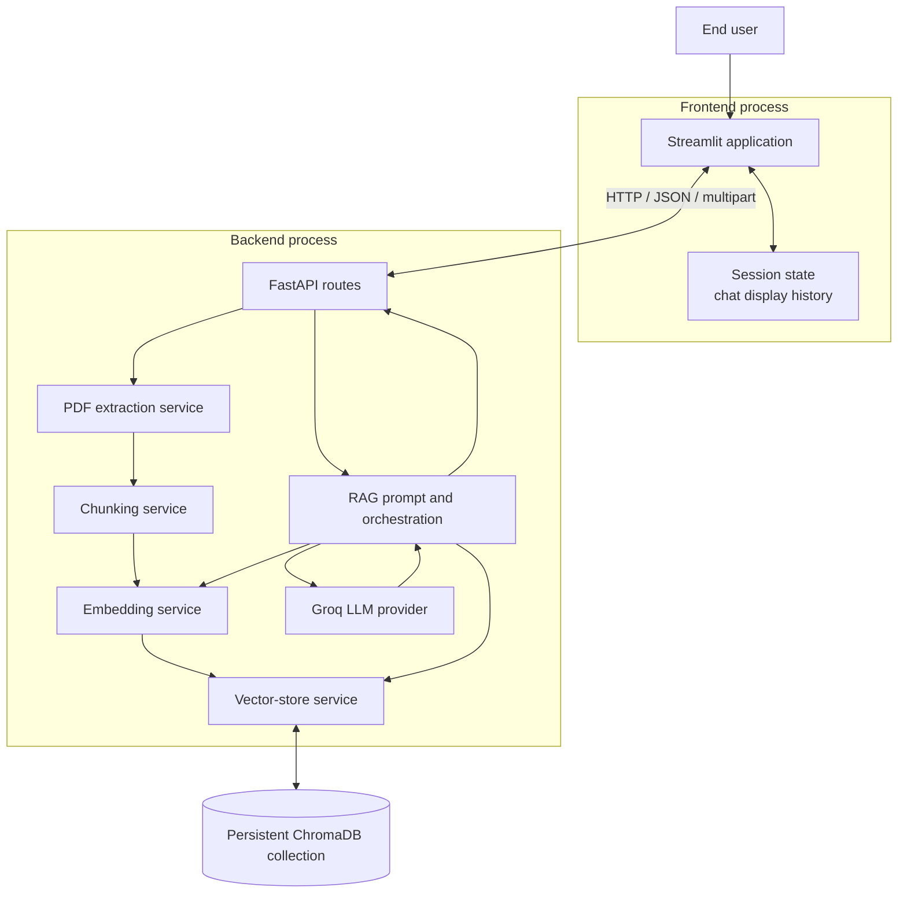
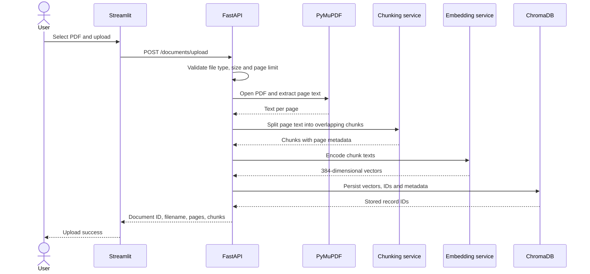
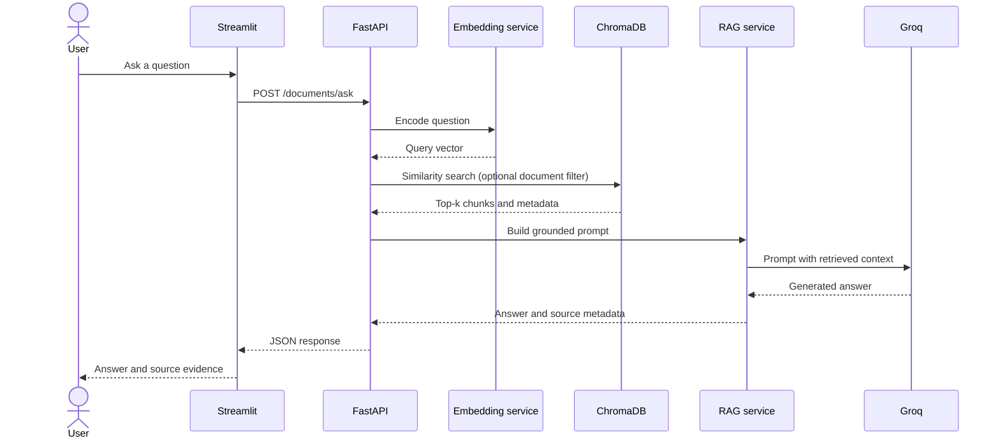
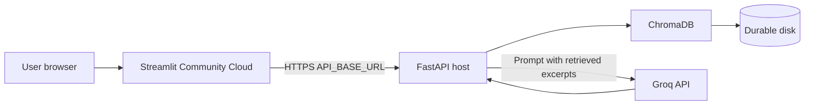

# DocuMind AI — Architecture

## 1. System context

The application has two user-facing/runtime layers:

- **Streamlit frontend:** collects uploads and questions, displays document inventory, answers, and source metadata.
- **FastAPI backend:** validates requests, processes PDFs, manages vector records, performs retrieval, and invokes the configured LLM provider.

The backend owns the document-processing and retrieval logic. The frontend communicates with it over HTTP.

## 2. PDF ingestion sequence

## 3. Question-answering sequence

## 4. Component responsibilities

| Component | Responsibility |
|---|---|
| `app/main.py` | FastAPI routes, request orchestration, HTTP responses |
| `app/services/chunking.py` | Page text splitting and overlap |
| `app/services/embeddings.py` | Load embedding model and encode text |
| `app/services/vector_store.py` | ChromaDB collection, insert, query, list and delete |
| `app/services/rag.py` | Context formatting and grounded prompt construction |
| `frontend/streamlit_app.py` | User interface and HTTP client calls |

## 5. Data model

A stored chunk is associated with a document ID and source metadata. The precise Chroma metadata fields should be checked against the current implementation before changing the schema.

Expected logical fields:

- `document_id`: groups chunks belonging to one uploaded PDF.
- `filename`: original uploaded filename.
- `page_number`: source page for citation.
- `text`: extracted chunk text, stored as the vector record's document content.
- vector embedding: numerical representation of the chunk.

The document inventory is reconstructed by grouping chunk metadata by `document_id`, counting chunks, and counting distinct page numbers.

## 6. Important design decisions

### Page-aware chunking

Chunking is performed per page. This retains a direct page reference for source display and avoids a chunk silently spanning two pages. The trade-off is that a relevant passage split across a page boundary may not be retrieved as one unit.

### Embeddings

The prototype uses `sentence-transformers/all-MiniLM-L6-v2`. The embedding model is cached in process memory and produces 384-dimensional vectors. The same model must be used for document chunks and user queries.

### Vector search

ChromaDB stores vectors persistently and performs similarity retrieval. The collection uses cosine distance. Distance is a ranking signal, not a calibrated probability or answer-confidence percentage.

### Grounded generation

The RAG prompt includes the question and retrieved source passages with filename/page information. The prompt instructs the model to answer from provided evidence and avoid inventing unsupported details. Prompt instructions alone are not a complete prompt-injection defence.

### LLM provider

The application uses a provider abstraction/configuration to select Groq or a mock provider. Mock responses are useful for testing integration but must never be represented as real model-generated answers.

## 7. Deployment topology

For a portfolio deployment, the frontend and backend can be hosted separately:

The vector database must use storage that survives restarts and deployments. If the selected hosting plan only provides ephemeral storage, do not use it for a persistent ChromaDB deployment with user uploads.
