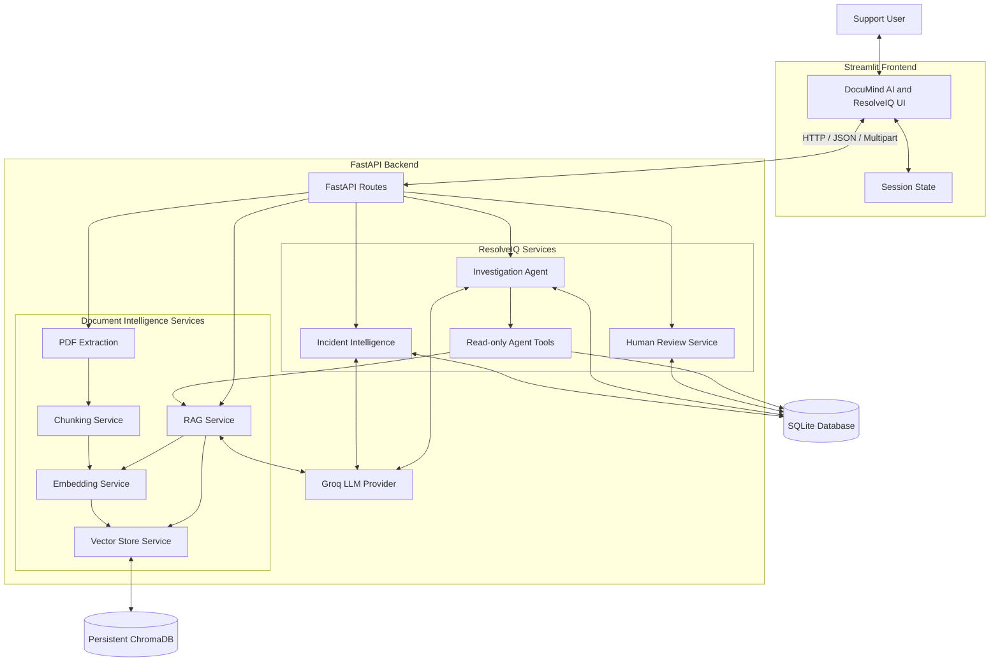
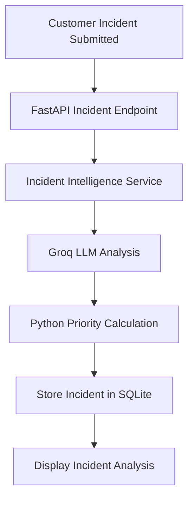
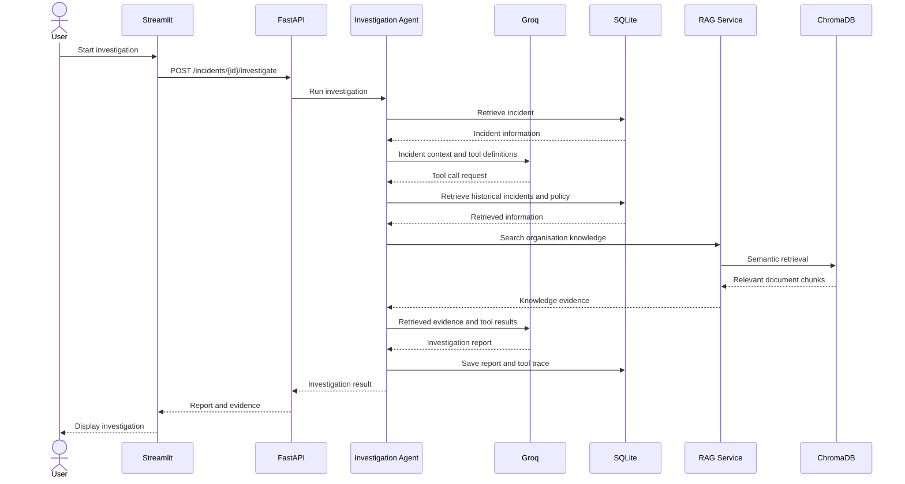
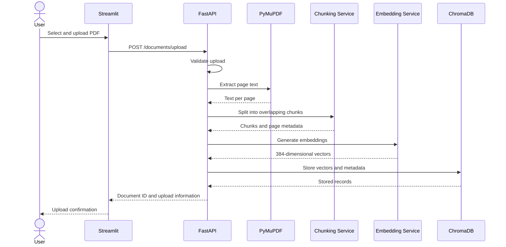
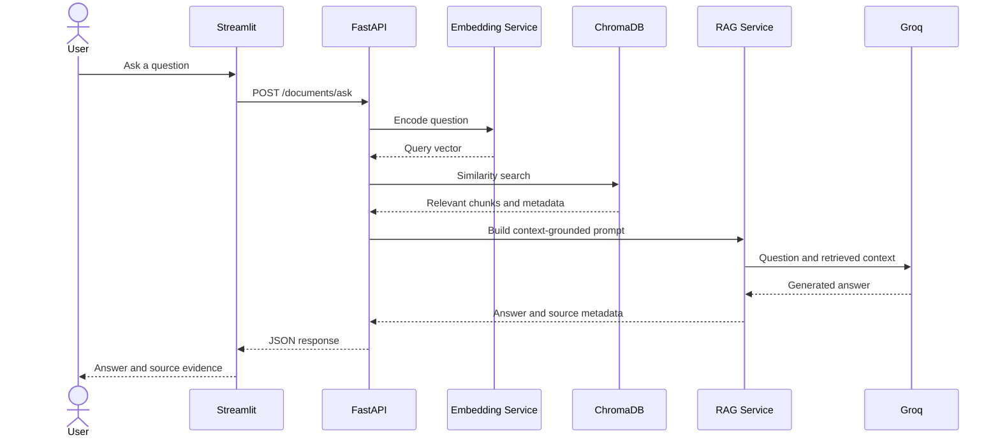
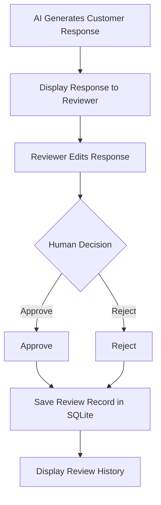
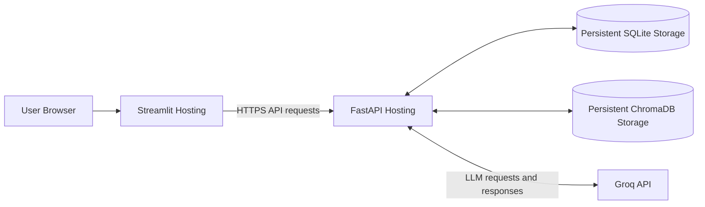

# ResolveIQ & DocuMind AI — System Architecture

## 1. System Overview

The application consists of two integrated AI capabilities:

- **ResolveIQ:** An AI-assisted service operations platform for incident intelligence, investigation, and human-reviewed customer responses.
- **DocuMind AI:** A Retrieval-Augmented Generation (RAG) document assistant that supports semantic search and context-grounded question answering.

The application uses a Streamlit frontend and a FastAPI backend. The backend coordinates AI services, document processing, database operations, and investigation workflows.

### Main architectural components

| Layer                 | Components                 | Responsibility                                                        |
| --------------------- | -------------------------- | --------------------------------------------------------------------- |
| Presentation          | Streamlit                  | User interface, incident workspace, document management, AI assistant |
| API                   | FastAPI                    | Request validation, endpoint handling, service orchestration          |
| Incident intelligence | `incident_intelligence.py` | Incident analysis, classification, priority calculation               |
| AI investigation      | `incident_agent.py`        | Tool-using investigation workflow                                     |
| Human review          | `human_review.py`          | Approval, rejection, response editing, review history                 |
| Document processing   | PyMuPDF, chunking service  | PDF extraction and text preparation                                   |
| Embeddings            | Sentence Transformers      | Convert document chunks and queries into vectors                      |
| Retrieval             | ChromaDB, RAG service      | Semantic search and context retrieval                                 |
| LLM                   | Groq                       | AI-generated analysis, responses, and investigation reasoning         |
| Persistence           | SQLite                     | Incident records, investigation reports, and review records           |

## 2. High-Level System Architecture

## 3. ResolveIQ — Incident Intelligence Workflow

Incident intelligence processes customer-reported information and generates an initial analysis.

### Workflow

1. A support user submits an incident through the Streamlit interface.
2. The frontend sends the incident information to the FastAPI backend.
3. The incident intelligence service prepares the input for AI analysis.
4. The Groq-hosted LLM assists with:
   - Incident categorisation.
   - Customer sentiment identification.
   - Incident summarisation.
   - Business-impact assessment.
   - Recommended actions.
   - Customer response drafting.
5. Python business rules calculate incident priority using severity, impact, and urgency.
6. The incident analysis and associated information are stored in SQLite.
7. The frontend displays the analysis for support-team review.

### Incident priority calculation

Priority is calculated independently of customer sentiment.

The demonstration implementation assigns numerical values to severity, impact, and urgency, then calculates a combined score.

| Priority | Score threshold | Demonstration response target |
| -------- | --------------: | ----------------------------: |
| P1       |    10 or higher |                        1 hour |
| P2       |             7–9 |                       4 hours |
| P3       |             4–6 |                      24 hours |
| P4       |         Below 4 |                      72 hours |

These are demonstration support-policy values, not externally verified contractual SLAs.

## 4. ResolveIQ — Agentic AI Investigation

ResolveIQ includes a central tool-using AI investigation agent.

Rather than relying only on the initial incident description, the agent can retrieve additional information through predefined read-only tools.

### Investigation tools

| Tool                            | Responsibility                                                             | Data source                |
| ------------------------------- | -------------------------------------------------------------------------- | -------------------------- |
| `get_customer_incident_history` | Retrieve relevant earlier incidents for the same organisation and customer | SQLite                     |
| `get_support_policy`            | Retrieve demonstration priority and response-target rules                  | Application support policy |
| `search_organisation_knowledge` | Search relevant organisation-specific support documents                    | ChromaDB and RAG services  |

### Investigation sequence

1. A support user selects an incident and starts an investigation.
2. The backend retrieves the incident record from SQLite.
3. The Groq LLM receives the incident information and available tool definitions.
4. The agent determines which retrieval tools are relevant.
5. The backend validates and executes the requested tools.
6. Retrieved information is returned to the agent.
7. The agent uses the retrieved evidence to prepare an investigation report.
8. The report, tools used, and tool trace are stored in SQLite.
9. The frontend displays the report for human review.

### Investigation safeguards

The investigation agent is designed with bounded tool interactions and predefined tool access.

- The agent uses read-only information retrieval tools.
- Tool execution is restricted to the application's available tool functions.
- Historical incidents are filtered to exclude the current incident and later-created records.
- Retrieved knowledge is scoped using the incident organisation identifier.
- Investigation reports distinguish retrieved evidence from assumptions and unknowns.
- The agent does not independently access external vendor systems, diagnose third-party infrastructure, or execute operational changes.

## 5. DocuMind AI — Document Ingestion Workflow

DocuMind AI provides the document ingestion and indexing capability used by both the standalone document assistant and ResolveIQ's knowledge retrieval workflow.

### PDF ingestion sequence

### Organisation-specific knowledge upload

ResolveIQ also provides a dedicated knowledge upload endpoint.

- Support documents are uploaded with an organisation identifier.
- Document metadata stores the normalised organisation identifier.
- The investigation agent obtains the relevant organisation from the incident record.
- Knowledge searches apply an organisation filter to retrieve relevant chunks.

This provides application-level organisation-scoped retrieval for the demonstration. It should not be treated as a complete production multi-tenant security implementation.

## 6. DocuMind AI — Question Answering Workflow

When a user asks a question, the application retrieves relevant document passages and supplies them to the configured LLM.

The RAG workflow is also used by the investigation agent when searching organisation-specific support documentation.

## 7. Human Review and Approval Workflow

Human review provides an explicit approval stage for AI-generated customer responses.

### Workflow

1. The support user selects an incident.
2. The generated customer response is displayed.
3. The reviewer can edit the response.
4. The reviewer approves or rejects the response.
5. The human review service records the decision in SQLite.
6. The review history is available through the application.

**Important:** Approval records a human decision. The current application does not send emails automatically or integrate with an external email service.

## 8. Component Responsibilities

| Component                               | Responsibility                                                              |
| --------------------------------------- | --------------------------------------------------------------------------- |
| `app/main.py`                           | FastAPI routes and backend request orchestration                            |
| `app/services/chunking.py`              | Split extracted document text into overlapping chunks                       |
| `app/services/embeddings.py`            | Load embedding model and generate text embeddings                           |
| `app/services/vector_store.py`          | ChromaDB collection management, insertion, retrieval, listing, and deletion |
| `app/services/rag.py`                   | Semantic retrieval and grounded answer generation                           |
| `app/services/incident_intelligence.py` | Incident analysis, priority calculation, and incident persistence           |
| `app/services/incident_agent.py`        | Investigation agent, tool definitions, execution, and report persistence    |
| `app/services/human_review.py`          | Human review decisions and review history                                   |
| `frontend/streamlit_app.py`             | Streamlit interface and backend HTTP client                                 |

## 9. Data Storage and Logical Data Model

The application uses two persistence systems.

### SQLite

SQLite stores structured operational information.

| Data             | Purpose                                                        |
| ---------------- | -------------------------------------------------------------- |
| Incidents        | Customer incident details, analysis, priority, and status      |
| Investigations   | Generated investigation reports and tool execution information |
| Incident reviews | Reviewer decisions, edited responses, and review history       |

### ChromaDB

ChromaDB stores document chunks and their vector embeddings.

Logical metadata includes:

| Field             | Purpose                                                    |
| ----------------- | ---------------------------------------------------------- |
| `document_id`     | Identifies the uploaded document                           |
| `filename`        | Original document filename                                 |
| `page_number`     | Source page reference                                      |
| `organisation_id` | Organisation scope for knowledge retrieval, where provided |
| Document content  | Extracted chunk text                                       |
| Embedding         | Numerical vector representation of the chunk               |

The document inventory is reconstructed by grouping chunk metadata by document identifier, counting chunks, and counting distinct pages.

## 10. Important Design Decisions

### Separation of responsibilities

FastAPI owns backend processing and business logic. Streamlit handles presentation and communicates with the backend over HTTP.

### Page-aware chunking

Text is split into chunks per PDF page. This preserves page references for source evidence. A trade-off is that passages spanning page boundaries may not be retrieved as one chunk.

### Embedding model

The prototype uses `sentence-transformers/all-MiniLM-L6-v2`.

The model generates 384-dimensional embeddings. The same embedding model must be used for document chunks and search queries.

### Vector retrieval

ChromaDB stores embeddings persistently and performs similarity retrieval. The collection uses cosine distance.

Distance is a ranking signal, not a calibrated probability or answer-confidence score.

### Grounded generation

The RAG service provides retrieved document passages as context to the LLM. Prompts instruct the model to use the available evidence and avoid inventing unsupported information.

Prompt instructions alone are not a complete defence against prompt injection.

### LLM integration

The application uses Groq-hosted models for AI analysis and generation. A mock provider is also available for testing selected integration paths.

Mock responses must not be presented as genuine model-generated results.

### Human oversight

AI-generated analysis and responses are recommendations for support personnel. Human review is required before a response is considered approved.

### Controlled agent tools

The investigation agent has access to predefined retrieval tools rather than unrestricted system or external-service access.

## 11. Deployment Architecture

The frontend and backend can be hosted separately for a future portfolio deployment.

### Deployment considerations

- Configure the frontend API base URL through environment variables.
- Store the Groq API key securely on the backend.
- Use persistent storage for SQLite and ChromaDB.
- Ensure uploaded documents and vector records survive application restarts.
- Avoid committing `.env` files, API keys, databases, or private uploaded documents.
- Use HTTPS for deployed frontend-to-backend communication.
- Restrict access to uploaded documents and operational records before exposing the application to multiple real customers.

A hosting platform with ephemeral storage is not suitable for this architecture unless persistent storage or an appropriate external database is configured.

## 12. Current Architectural Limitations

The current implementation is a portfolio demonstration rather than a production-ready enterprise platform.

Known limitations include:

- No user authentication or role-based access control.
- No complete production-grade tenant isolation.
- No real email delivery integration.
- No direct external vendor, CRM, monitoring, or ticketing integrations.
- No autonomous execution of external operational actions.
- No OCR processing for scanned PDFs.
- No production-grade distributed task queue.
- No comprehensive production monitoring or rate limiting.
- Demonstration support policies require configuration for real organisations.

These limitations define the boundary between the current implementation and potential future production development.
